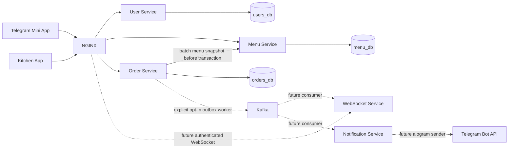

# Architecture overview

Status: Stages 1–3 plus SCRUM-17 standalone Outbox worker, implemented for review.
User/Menu APIs and transactional orders remain unchanged. The opt-in worker can publish existing
v1 events; Notification/WebSocket processing and frontend flows remain deferred.
See [Outbox launch/recovery](../stages/stage-4-outbox.md); ordinary Compose startup never launches it.
See [authentication](authentication.md) and [Stage 3](../stages/stage-3.md).

## Components and trust boundaries

| Component | Owns | Runtime / dependencies |
| --- | --- | --- |
| User Service | Users, Telegram client authentication, separate staff password accounts, JWT issuance, profiles, roles | FastAPI; users_db |
| Menu Service | Categories, dishes, prices, availability | FastAPI; menu_db |
| Order Service | Orders, line-item snapshots, slots, idempotency, transactional outbox | FastAPI; orders_db |
| Notification Service | Telegram delivery and durable processing state design | FastAPI shell; future aiogram and Kafka consumer |
| WebSocket Service | Authorized employee connections and event delivery | FastAPI shell; future native WebSocket and Kafka consumer |
| Telegram Mini App | Customer interaction and temporary cart state | Static Next.js export |
| Kitchen App | Adaptive staff/admin interface, including Android tablets | Static Next.js export |
| NGINX | Static-app routing, HTTP forwarding, future WebSocket upgrade | Reverse proxy only; no business logic |

The estimated 1,000–2,000 HTTP requests/hour is a planning input, not a measured capacity claim. Five services follow the agreed architecture; no additional gateway, Redis, Kubernetes, gRPC, schema registry, or orchestration layer is introduced.

All client input is untrusted. Stage 2 validates Telegram initData/freshness, separately authenticates staff passwords, issues RS256 JWTs, and enforces User/Menu access. Order Service independently validates JWTs, roles and ownership. NGINX is not an authorization boundary. Internal network access is not sufficient authentication for privileged operations. Local JWT distribution uses environment-provided RSA public keys; production rotation and internal-service authentication remain open.

## Local routing

| External path | Upstream behavior |
| --- | --- |
| `http://localhost:8080/` | Mini App static export |
| `http://localhost:8081/` | Kitchen App static export |
| `/api/v1/users/…` | User Service; remove the prefix |
| `/api/v1/menu/…` | Menu Service; remove the prefix |
| `/api/v1/orders/…` | Order Service; remove the prefix |
| `/health/{user,menu,order,notification,websocket}/{live,ready}` | Operational health endpoints |
| `/api/v1/ws/kitchen` | Reserved WebSocket route; currently rejected, no WS handler |

API routes are available on both origins. For example, `/api/v1/users/health/live` reaches the same endpoint as `/health/user/live`. Prefix stripping is intentional: future service routers must not repeat these external prefixes. Bare User/Menu prefixes redirect to their trailing-slash equivalents. The bare Order collection is forwarded directly, preserving POST requests. Unknown API paths return backend 404 responses, not frontend HTML.

Each backend listens on container port 8000. Only NGINX, host PostgreSQL, and the Kafka external listener publish ports, all bound to localhost. Both frontends use relative API URLs when served through NGINX. Host Next.js dev servers run on 3000/3001; API integration through those origins is not configured in Stage 1.

## Runtime and development model

Python 3.12 services have independent uv projects, lockfiles, and environments. SQLAlchemy 2.x uses asyncpg. Alembic runs as an explicit operator command, never in application startup. User/Menu/Order contain initial schema revisions. Only User, Menu, and Order have relational database adapters. Notification and WebSocket shells do not connect to Kafka or Telegram and their readiness proves only process availability.

Node 22 runs Next.js 16 / React 19 builds with Tailwind 4. Both apps have TanStack Query providers, Zustand dependencies, local UI conventions, and Russian placeholder text. The maintained Telegram Mini Apps React SDK (`@tma.js/sdk-react`) is installed but not initialized. Browser APIs must be used only on the client in later stages.

Static export excludes server actions, server-side sessions, and runtime Next.js APIs. `next/image` optimization is disabled. Fonts use a local system stack to avoid build-time network requests. Actual Telegram usage later requires an HTTPS URL; localhost HTTP is only a browser development setup.

PostgreSQL uses one local instance with three logically isolated databases. Kafka uses one combined KRaft broker/controller with plaintext listeners and replication factor one: strictly local development settings. No application topic is provisioned automatically. The opt-in Outbox worker requires a pre-existing
topic; application consumers remain deferred. Local verification uses only disposable test topics.

## Suggested ownership for five people

| Owner | Primary area | Early coordination |
| --- | --- | --- |
| 1 | User Service and authentication decisions | Agree JWT and role contracts with all API owners |
| 2 | Menu Service | Agree authoritative menu snapshot response with Order owner |
| 3 | Order Service and event contracts | Coordinate slot invariants and outbox with consumer owners |
| 4 | Mini App | Integrate auth/menu/order contracts; keep UI state local |
| 5 | Kitchen App, WebSocket and Notification integration | Agree staff auth, event consumption and Telegram permission flow |

This is a proposed division, not a staffing requirement. Infrastructure and contract changes require review by affected owners. Keep service environments and migrations independent; review each lockfile change with its manifest.

## References

- [Next.js static export constraints](https://nextjs.org/docs/app/guides/static-exports)
- [Tailwind CSS with Next.js](https://tailwindcss.com/docs/installation/framework-guides/nextjs)
- [Compose startup and health conditions](https://docs.docker.com/compose/how-tos/startup-order/)
- [Kafka supported releases](https://kafka.apache.org/community/downloads/)
- [Telegram server-side initData validation](https://core.telegram.org/bots/webapps#validating-data-received-via-the-mini-app)

The referenced Penpot chats provide visual context only. Payment, maps, multiple cafeterias, health-related profile fields, and other simulated prototype behavior are not Stage 1 requirements.
